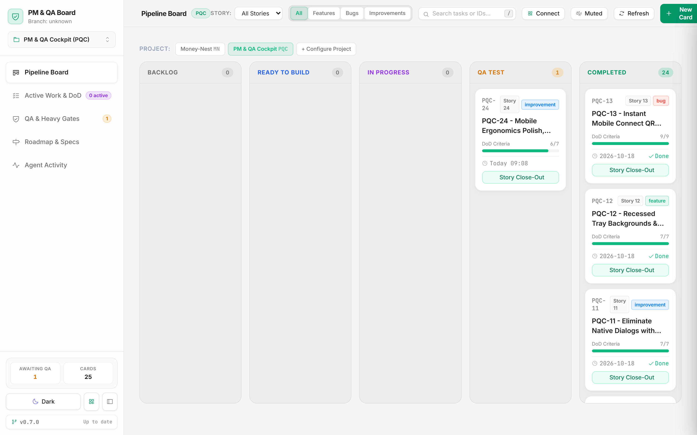
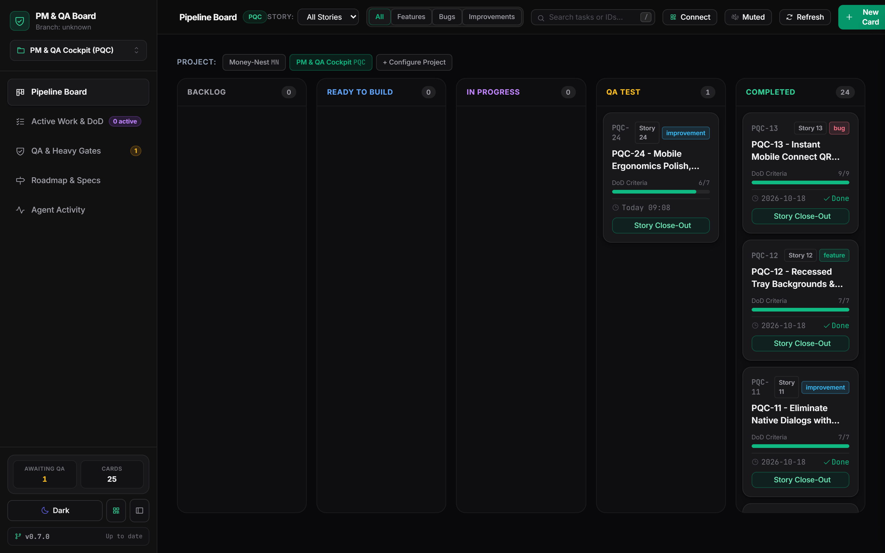
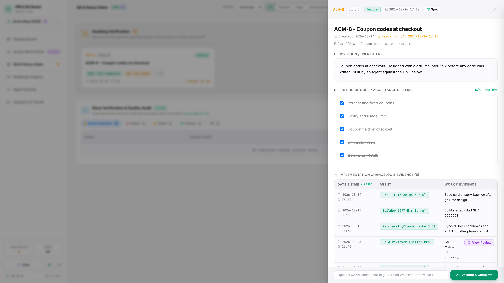
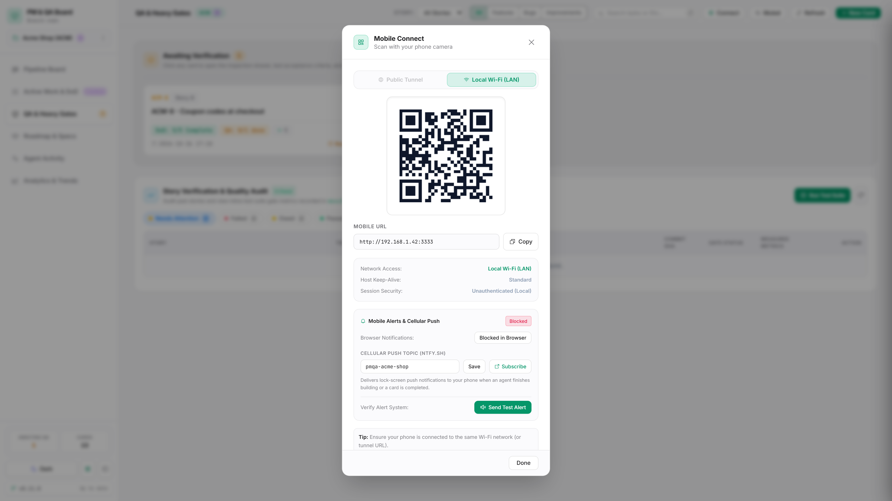
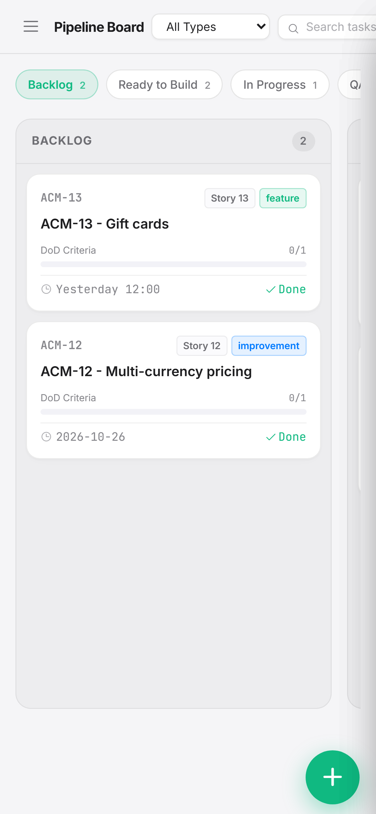
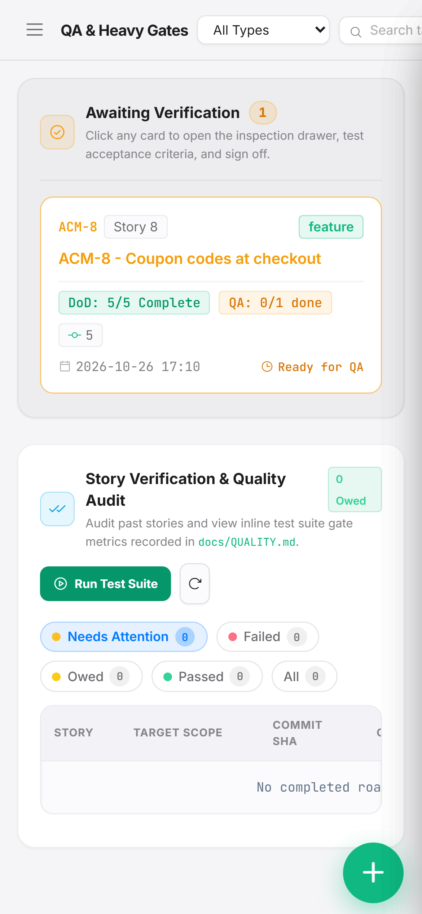

# PM & QA Board

<p align="center">
  <strong>A local-first, zero-dependency dashboard and agent orchestration framework for high-velocity software engineering.</strong><br>
  Built for <strong>Claude Code</strong>, <strong>Cursor</strong>, <strong>Google Antigravity</strong>, <strong>OpenAI Codex</strong>, and autonomous AI coding agents.
</p>

<p align="center">
  
  
  
  
  
  
</p>

---

## Overview

**PM & QA Board** transforms agent-driven development into a structured, verifiable, and audit-proof workflow. Instead of losing context in long chat sessions, all engineering work is tracked on disk as **stories**: structured Markdown cards with unambiguous Definitions of Done (DoD), cold-review verdicts, automated test gates, and interactive Human QA sign-off artifacts.

There is **no database**, **no external cloud service**, and **no sync drift**. The dashboard reads and writes Markdown files directly on your local filesystem. Combined with an agent skill suite (`pm-orchestrate`, `pm-qa-setup`, `pm-review`, `pm-sync`, `pm-qa-cockpit`), it gives you and your AI coding partners a shared, repeatable loop from design interview through final QA sign-off.

> **Zero-surprises guarantee:** The tool never pushes to Git without your explicit confirmation, never overwrites your project's custom rules or instructions without approval, and keeps your private project data completely decoupled from public code repositories.

---

## Visual Showcase

### Desktop Pipeline Board & Dual-Theme UI
Experience a desktop interface designed around Apple Daylight and Carbon Zinc aesthetics. View stories across the complete development lifecycle: **Backlog**, **Ready to Build**, **In Progress**, **QA Test**, and **Completed**.

<p align="center">
  
</p>

<details>
  <summary>🌙 <strong>View Carbon Zinc Dark Theme</strong></summary>
  <br>
  <p align="center">
    
  </p>
</details>

---

### Dedicated QA Station & Slide-Over Inspection Drawer
Every card moving to QA provides live acceptance checklists, automated gate status badges, implementation changelogs, and direct links to interactive Close-Out deliverables. Inspect cards with full context in a slide-over drawer without losing board state.

<p align="center">
  
</p>

---

### Instant Mobile Integration & QR Remote Access
Take your QA testing anywhere on your local Wi-Fi or on the go via secure Cloudflare Quick Tunnels with one-click QR code pairing.

<p align="center">
  
  &nbsp;
  
  &nbsp;
  
</p>

---

## Key Features

### 1. 📱 Mobile Integration & Remote Access
- **Instant Camera QR Pairing:** Launch with `powershell -File dashboard.ps1 -Mobile` or `-Public` to print a terminal QR code, or click the **Connect** button in the header toolbar to display a high-resolution QR modal. Point your smartphone camera at the screen to immediately open the dashboard on your phone.
- **Dual Connection Paths:**
  - **Local Wi-Fi (LAN):** Automatically resolves your machine's local IPv4 network address for ultra-fast, zero-cloud access within your home or office Wi-Fi.
  - **Public Cloudflare Quick Tunnel:** Spin up an ephemeral, encrypted Cloudflare Tunnel on demand (`trycloudflare.com`) with automated session tokens (`?token=...`) to test from anywhere over cellular without opening router ports.
- **Windows Host Keep-Alive:** Uses native Windows power management APIs (`SetThreadExecutionState`) to prevent host sleep or sleep transitions while a mobile testing session is active.
- **Mobile-First Ergonomics:** Full responsive support with horizontal column scroll snapping (`scrollToColumn`), touch-friendly slide-over inspection drawers, compact type pills, and sticky QA validation footers.
- **Web Audio Chimes & Push Notifications:** Built-in Web Audio synth engine announces QA transitions with pleasant audio cues. Includes optional cellular push notifications via [ntfy.sh](https://ntfy.sh).

### 2. ⚡ Live Data & Real-Time Agent Reactivity
- **Zero Polling Lag / File Watcher:** The cockpit monitors your project's story files on disk in real time. When an agent updates a DoD criterion or creates a card, the UI updates reactively.
- **Active Work Streams & Live DoD:** The **Active Work & DoD** view shows real-time concurrent development lanes, active builder agents, and granular completion percentages for work in progress.
- **Active Grill Lane:** Automatically detects active design interviews or RFC discussions (`grill-me` skill), giving you early visibility into requirements refinement before any code is committed.
- **Real-Time Telemetry:** Instant counters for cards awaiting QA, total cards, test execution durations, and gate health.
- **In-App Git Sync & Update Manager:** Inspect current branch name, commit SHA, and upstream sync status directly from the header toolbar.

### 3. 🛡️ Human-in-the-Loop QA & Close-Out Artifacts
- **Interactive Story Close-Out (`.html`):** When a story reaches `qa`, the agent generates a standalone, interactive delivery page (`<docs>/artifacts/<PREFIX>-<story>-closeout.html`). It encapsulates the story scope, visual before/after evidence, test metrics, and live Human QA verification checkboxes.
- **One-Click Sign-Off:** Reviewers can click **Validate & Complete Story** directly inside the Close-Out artifact or from the QA Station to transition the story to `completed`, stamp the completion timestamp, and commit changes.
- **Cold Review Gate:** Enforces an independent, diff-only code review (`pm-review`) by a designated stronger model before any story reaches the QA column.

### 4. 🪶 Zero Runtime Dependencies & Local-First Architecture
- **Standard Library Only:** The core HTTP server (`board/server.py`) uses Python 3.12+ standard library modules (`http.server`, `threading`, `subprocess`, `urllib`, `json`). No heavy runtime web frameworks (no Flask, FastAPI, Node, or Django required to run).
- **Disk is the Source of Truth:** All project status is stored in clean, human-readable Markdown files. You can edit cards in VS Code, Obsidian, Neovim, or Notepad; the board reflects edits instantly.
- **In-Repo vs. External Private Docs:**
  - **In-repo mode:** PM files live under `<project_root>/docs/`.
  - **External docs mode (`--docs-path`):** PM files live in a separate, private repository (e.g., `../pm-qa-docs/<slug>/`). Keeps sensitive roadmap data, internal reviews, and business context out of public open-source repos. Optional `--stealth` flag automatically keeps local cockpit helper files excluded via `.git/info/exclude`.

### 5. 🤖 Multi-Agent Ecosystem Parity (Claude Code, OpenAI Codex, Antigravity, Cursor)
PM & QA Board provides first-class support for the leading autonomous AI coding agent tools, with automatic detection, non-destructive instruction wiring, and specialized multi-agent model rosters:

| Agent Engine | Project Directives | Skills Directory | Global Discovery | Roster Path | Default Lead Model |
|---|---|---|---|---|---|
| **Claude Code** | `CLAUDE.md` | `.claude/skills` | `~/.claude/skills` | `.claude/agents` | `claude-opus-5-5` |
| **OpenAI Codex** | `CODEX.md` | `.agents/skills` | `~/.agents/skills` | `.agents/agents` | `gpt-5.6-terra` |
| **Google Antigravity** | `AGENTS.md` / `GEMINI.md` | `.agents/skills` | `~/.agents/skills` | `.agents/agents` | `pro` |
| **Cursor** | `.cursorrules` / `AGENTS.md` | `.claude/skills` | `~/.cursor/skills-cursor` | `.cursor/agents` | `composer-2.5` |

- **Dedicated Codex Roster:** Tailored frontier model pins optimize each phase of the story loop:
  - **Lead & Builder** (`gpt-5.6-terra`): Frontier engineering, complex multi-step reasoning, surgical diffs, and tool execution.
  - **Advisor & Reviewer** (`gpt-6.1-sol`): Cold peer review, edge-case discovery, security auditing, and design interview (`grill-me`).
  - **Retrieval & PM-Sync** (`gpt-6-luna`): Sub-second codebase indexing, symbol search, card status transitions, and changelog updates.
- **Shared Skills Architecture:** Codex and Antigravity cleanly share `.agents/skills` without duplicate installations or directory conflicts.
- **Doctor Health Audits:** `cli.py doctor` inspects project and global skill states across all detected tools, highlighting outdated, edited, or missing skills.

---

## Quick Start

### 1. Installation (Once per Machine)

Clone the repository into your user directory and run the non-destructive bootstrap installer:

```powershell
# 1. Clone the running copy to your user profile
git clone https://github.com/getuliojr/pm-qa-board $HOME\.pm-qa-board\app

# 2. Preview what the installer will do (Dry Run)
powershell -NoProfile -File $HOME\.pm-qa-board\app\install.ps1 -DryRun

# 3. Install the bootstrap skill (installs only pm-qa-setup; never overwrites existing skills)
powershell -NoProfile -File $HOME\.pm-qa-board\app\install.ps1
```

---

### 2. Set Up a Project (Agent-Guided)

Open your target project in your preferred agent tool (**Claude Code**, **Cursor**, **Google Antigravity**, **OpenAI Codex**, etc.) and prompt:

> **"Set up PM & QA Board in this project"**

The agent runs `cli.py setup-plan <project>`, inspects your environment, and presents a clear summary:
1. **Current setup:** Existing agent configurations, PM data location, hooks, and gates.
2. **Recommended plan:** Target skill locations, docs location, and gate profiles.
3. **Up to 4 clarifying questions:** You approve where PM docs live, where skills are installed, and your preferred gate mode.

Once approved, the agent executes `cli.py setup-apply` and validates the installation with `cli.py doctor <project>` to ensure everything is operating cleanly.

---

### 3. Launching the Dashboard

Launch the web dashboard by double-clicking the **PM & QA Board** shortcut on your Desktop, or launch from PowerShell:

```powershell
# Standard local desktop launch (http://localhost:3333)
powershell -File $HOME\.pm-qa-board\app\dashboard.ps1

# Launch with mobile LAN Wi-Fi pairing enabled
powershell -File $HOME\.pm-qa-board\app\dashboard.ps1 -Mobile

# Launch with public Cloudflare Quick Tunnel (with secure session token)
powershell -File $HOME\.pm-qa-board\app\dashboard.ps1 -Public

# Launch and select a specific registered project
powershell -File $HOME\.pm-qa-board\app\dashboard.ps1 -Project my-app -Port 3333
```

---

## Project Structure & Isolation

To ensure that in-development changes never destabilize active client projects, PM & QA Board enforces a clean three-layer separation:

| Layer | Location | Purpose & Sync |
|---|---|---|
| **Dev Clone** | Your local git clone of this repository | Where you develop and test new cockpit features on local branches. |
| **Running Copy** | `~/.pm-qa-cockpit/app` | Stable copy cloned from `main` that projects use to serve the dashboard. Updated via `git pull`. |
| **PM Data** | `<project>/docs` or `pm-qa-docs/<slug>/` | Project story cards, acceptance criteria, reviews, and close-out artifacts. |
| **Registry** | `~/.pm-qa-cockpit/projects.json` | Local per-machine configuration linking project slugs, paths, gate profiles, and notification preferences. |
| **Agent Skills** | `.claude/skills`, `.agents/skills` (Antigravity & Codex), `~/.cursor/skills-cursor` | Modular prompt skills providing the 7-step story workflow to AI agents. |

---

## The 7-Step Story Working Loop

Every feature or bugfix built under the PM & QA Cockpit framework follows the standard story loop (`skills/pm-orchestrate/SKILL.md`):

```
       [ 1. Grill-Me ]           --> Clarify requirements, edge cases & scope
              │
       [ 2. Card In-Progress ]   --> Create/update markdown card with DoD
              │
       [ 3. Local Commits ]      --> Build iteratively with incremental DoD sync
              │
       [ 4. Automated Gates ]    --> Run inline fast static + unit test suite
              │
       [ 5. Cold Review ]        --> Diff-only independent reviewer approval
              │
       [ 6. Story Close-Out ]    --> Generate interactive HTML deliverable
              │
       [ 7. Human QA Sign-Off ]  --> Live verification checks & completion
```

### Gate Modes: Fast vs. Heavy
The built-in gate profiler (`cli.py profile-gates --measure --apply`) benchmarks your test and lint suite against a 360-second threshold:
- **Fast Mode (<= 360 s):** The agent runs the full test suite inline before requesting review.
- **Heavy Mode (> 360 s):** The agent runs fast unit checks inline; full regression suites are decoupled into a dedicated `finalgates.ps1` script triggered from the QA Station or by the user.

---

## Story Card Schema

Story cards live in `<docs>/cards/<PREFIX>-<story> - <Title>.md` with clean YAML frontmatter:

```markdown
---
id: PQC-24
story: 24
type: improvement
status: in-progress      # backlog | story-backlog | in-progress | qa | completed
created: 2026-10-20 09:00
validated: null
---

## Description
Clear user intent and functional scope.

## Definition of Done / Acceptance Criteria
- [x] Responsive layout adapted for mobile viewports
- [x] Dedicated slide-over drawer for card inspection
- [ ] Automated regression tests passing

## Human QA Test
### Verification Check
- [ ] Open card on mobile browser and verify sticky validation bar
- [ ] Tap 'Validate & Complete' and verify instant card transition

## Changelog
| 2026-10-20 09:55 | Builder (Claude 3.5 Sonnet) | Responsive drawer implementation |
```

---

## Extra card tags

A project can show extra values from card frontmatter (for example an external ticket key or an iteration
number) as pills on the board, optionally as links, and filter the pipeline board by them. Declare them in the
project's registry entry in `~/.pm-qa-cockpit/projects.json`:

```json
"extra_tags": [
  {"key": "ticket", "label": "Ticket", "link": "https://tracker.example.com/browse/{value}", "filter": true},
  {"key": "iteration", "label": "Iteration", "filter": true}
]
```

`key` is the frontmatter key (required); `label` defaults to the key; `link` is an `http(s)` URL template where
`{value}` is replaced by the URL-quoted value; `filter: true` adds a dropdown above the pipeline board. Then add
bare lines to a card's frontmatter:

```yaml
ticket: EXAMPLE-123
iteration: 7
```

- Digits-only values show with their label (`Iteration 7`); other values show alone (`EXAMPLE-123`).
- Frontmatter keys that are not declared are ignored, and nothing changes for projects without `extra_tags`.
- If a key is declared twice, the first declaration wins.
- Declarations are read when a project is activated: after editing the registry file, restart the board or
  select the project again.
- `uv run python board/cli.py tags` lists the declarations of the resolved project.

---

## CLI Reference

The zero-dependency CLI (`board/cli.py`) handles all automation and management tasks:

```powershell
# List registered projects and active selection
uv run python board/cli.py projects [--select <slug>]

# Register a new project
uv run python board/cli.py init <slug> --code-path <path> [--docs-path <path>] [--prefix <PRFX>]

# List the extra card tags declared for a project
uv run python board/cli.py --project <slug> tags

# Run environment health check
uv run python board/cli.py doctor [<slug>]

# Profile test suite and set fast/heavy gate mode
uv run python board/cli.py profile-gates <slug> --measure --apply

# Inspect installed skill status and check for updates
uv run python board/cli.py skills-status <slug>

# Generate or apply agent-guided setup plans
uv run python board/cli.py setup-plan <slug>
uv run python board/cli.py setup-apply <slug> --answers-json <path>
```

---

## Development & Testing

Run the comprehensive test suite locally using `uv`:

```powershell
uv run --system-certs --group dev pytest -q
```

To capture fresh high-resolution screenshots for this documentation:

```powershell
node scripts/capture_screenshots.js
```

---

## License

MIT License. Designed with care for high-autonomy pair-programming workflows.
